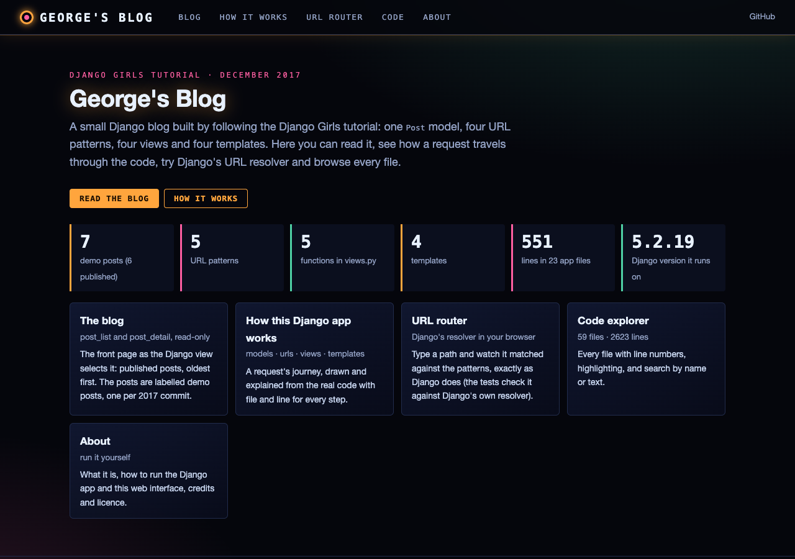
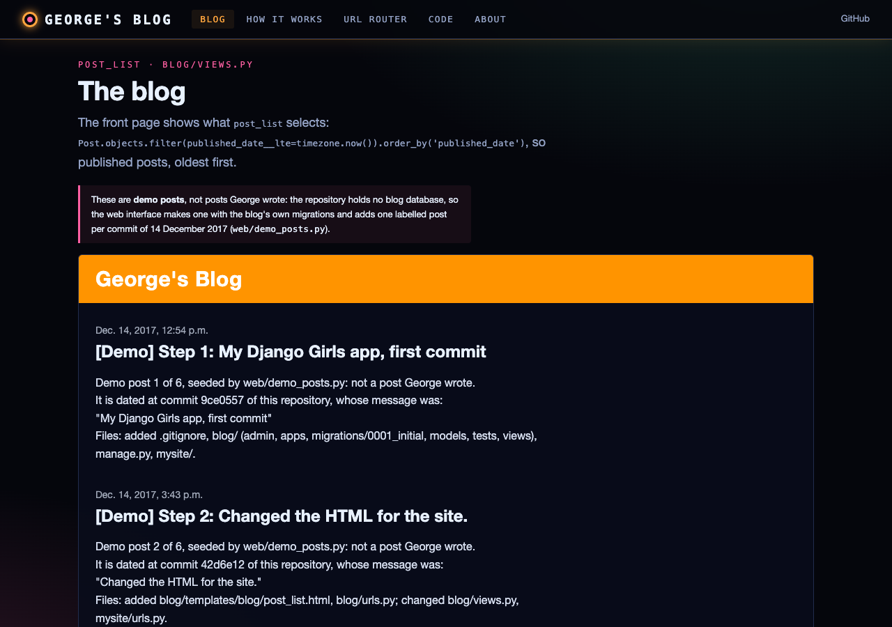
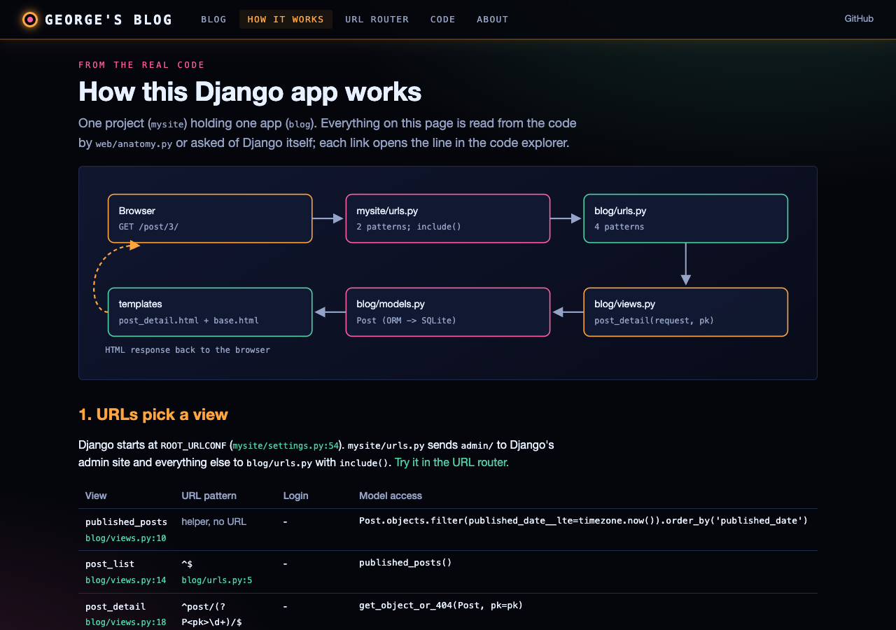
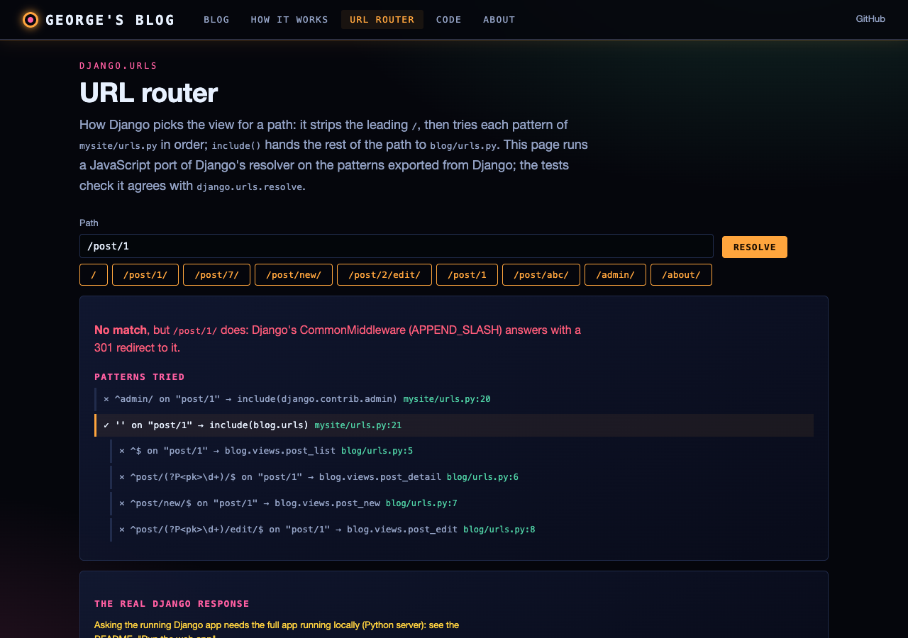
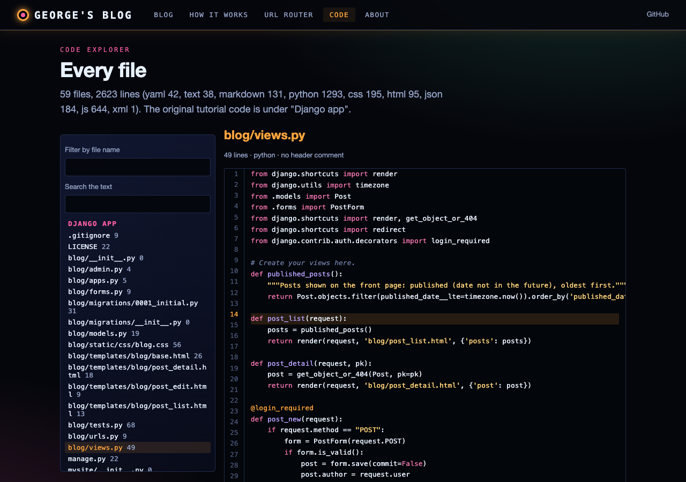

# George's Blog (my-first-blog)

The blog George built on 14 December 2017 by following the [Django Girls tutorial](https://tutorial.djangogirls.org/):
one `Post` model, four URL patterns, four views and four templates (list, detail, new/edit), in the Django project
`mysite` with the app `blog`. An earlier 2016 attempt is in
[my-first-blog_old](https://github.com/gddickinson/my-first-blog_old).

**Web site:** https://gddickinson.github.io/my-first-blog/ (the blog read-only, how the Django app works, a URL
resolver and a code explorer).

## Run the Django app

```bash
pip install Django==5.2.19
python manage.py migrate
python manage.py createsuperuser    # log in at /admin/ to write posts
python manage.py runserver          # http://127.0.0.1:8000
python manage.py test blog          # the blog's tests
```

The code was written for Django 1.11, which no longer imports on current Python. In 2026 it was moved to Django 5.2 LTS
with the smallest changes possible: `on_delete=models.CASCADE` on `Post.author` (what the 2017 migration already
records), `re_path` instead of `django.conf.urls.url`, `` instead of `staticfiles`, and
`DEFAULT_AUTO_FIELD = AutoField`. `SECRET_KEY` is read from the `DJANGO_SECRET_KEY` environment variable (a dev-only
default keeps `runserver` working); set it for any public deployment.

## Run the web app

```bash
pip install -r requirements-web.txt
python run_web.py                   # http://127.0.0.1:8256
```

A FastAPI shell (`web/`) presents the blog with the house web interface and mounts the real Django blog at
`/django/`. It uses `mysite/settings_demo.py`: a separate demo database in `.web_demo/` (or the file named by
`BLOG_DEMO_DB`), created by the blog's own migrations and seeded with clearly labelled demo posts, one per commit of
14 December 2017 (`web/demo_posts.py`). The repository holds no real posts.

Pages:
- **Blog**: the front page as `post_list` selects it (published posts, oldest first), each post as `post_detail`
  shows it, and the unpublished draft that the filter hides. Text and dates are rendered by Django's own filters.
- **How it works**: the request flow (diagram), the URL patterns, views, model fields and methods, form, templates,
  settings and migration, all read from the code by `web/anatomy.py` with a file:line link for each.
- **URL router**: a JavaScript port of Django's URL resolver (`web/static/url_engine.js`) run on the patterns exported
  from Django, with every pattern tried, kwargs and the APPEND_SLASH redirect. On the local app, "Ask Django" GETs the
  path from the real blog.
- **Code**: every file, with line numbers, highlighting and search by name or text (secret-looking strings redacted).
- **About**: what it is, how to run it, credits.

The static site (`python scripts/build_static.py`) exports the same pages with the API answers as JSON; it is
published by `.github/workflows/pages.yml` on every push to `master`.

| Home | Blog |
|---|---|
|  |  |
| **How it works** | **URL router** |
|  |  |



### Tests

```bash
python -m pytest -q tests                     # API, static build, Django's own blog tests, JS resolver vs Django
node web/static/url_engine.test.mjs           # url_engine.js against tests/fixtures/resolve_cases.json
python scripts/make_resolve_fixture.py        # regenerate the fixture after changing a urls.py
python scripts/screenshots.py --static '' blog how router code about   # browser smoke test (Playwright)
```

## Licence

MIT, see [LICENSE](LICENSE).
